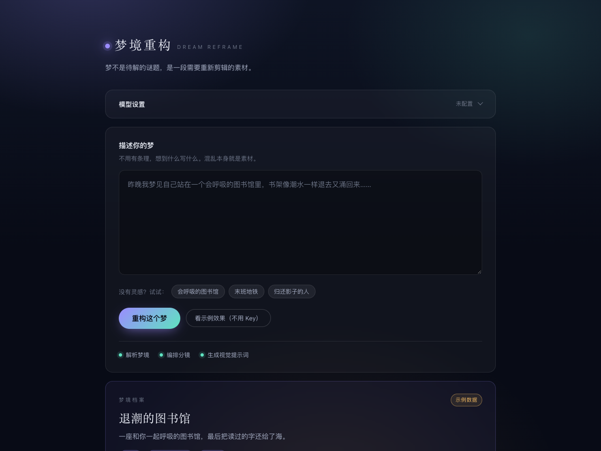
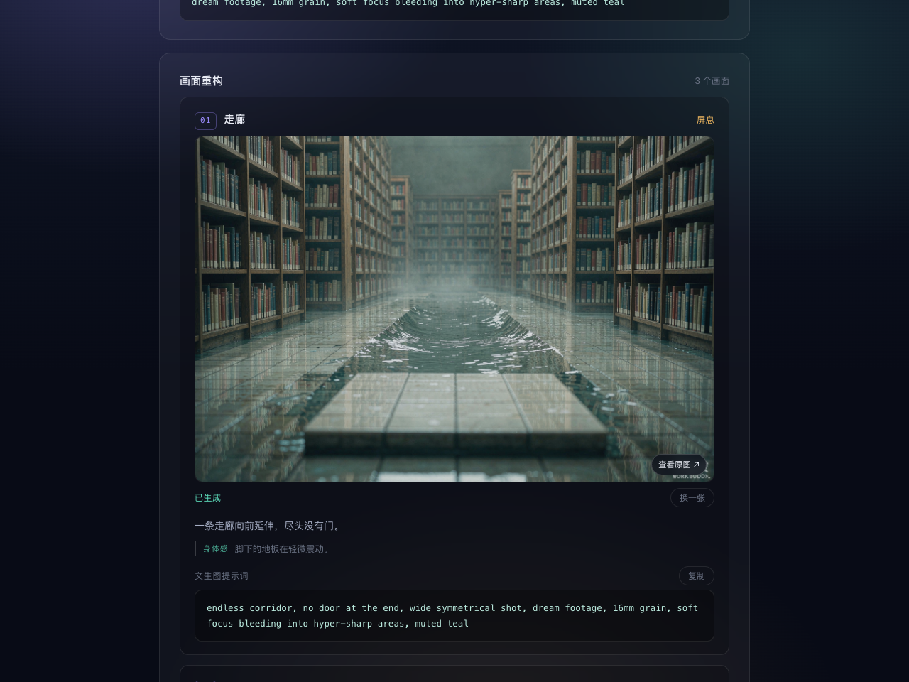

# 梦境重构 · Dream Reframe

> 梦境稍纵即逝，把一段醒来后即将遗忘的梦，重构成可以被看见的画面，将梦境珍藏。

**在线体验**：https://960668.github.io/dream-reframe/



## 这是什么

你刚醒来，脑子里还残留着一些画面：会呼吸的书架、退潮的瓷砖地、一道没有尽头的玻璃楼梯。你随手把它打出来——顺序是乱的，因果是缺的，五分钟之后它就会消失。

**梦境重构**不解释这个梦意味着什么，它做四件事：

1. **解析**：从混乱的口述里抽出核心意象、情绪基调、关键场景
2. **还原**：把素材重新组织成 2-5 个画面，每个画面带情绪和身体感
3. **视觉化**：为每个画面写一段英文提示词，并生成一条统一的**风格锚点**，保证几张图看起来出自同一个梦
4. **出图（可选）**：接上免费的文生图模型（如：智谱 CogView-3-Flash / 硅基流动 Kolors），在页面里直接把每个画面变成图，单张可重新生成

即使不出图，提示词也可以一键复制到 Midjourney / 即梦 / Stable Diffusion，或导出为 JSON 留档。



## 一键出图

在「模型设置 → 出图」里选一个带出图能力的服务商：

| 服务商 | 出图模型 | 费用 | 备注 |
|---|---|---|---|
| 智谱 GLM | `cogview-3-flash` | **免费** | 注册只要手机号，推荐首选 |
| 硅基流动 | `Kwai-Kolors/Kolors` | 输出免费 | 需先完成实名认证；支持 negative_prompt |
| OpenAI | `gpt-image-1` | 付费 | 浏览器不能直连，仅本机 + 代理可用 |

行为说明：

- 默认**重构完成后自动出图**，逐张串行生成（免费模型有并发限制，串行最稳）
- 关掉「自动出图」后，每个画面下有「生成这张」按钮，想出哪张点哪张
- 已经生成的画面可以点「换一张」单独重生成，不影响其他画面
- 单张失败（限流、内容审核）不会中断整批，失败的卡上会写明原因，点「重试」即可
- 没有出图能力的服务商（如 DeepSeek）照常可用：文字链路不变，提示词拿去别处出图

## 风格锚点的实际效果

下面两张图来自同一个梦境的两个画面，提示词完全由链路生成，没有人工修改。它们共享同一条风格锚点，所以色调、质感、影调是一致的——这就是跨画面一致性的解法。

**画面 01 · 潮水退去**


**画面 04 · 字回到海里**


> 这两张成片由项目早期版本的风格锚点生成。当前锚点已转向「梦境质感」（见下方设计取舍），用当前提示词重新生成两张图是待办之一。

## 快速开始

不需要安装任何依赖，只要 Node 18+。

```bash
git clone https://github.com/<你的用户名>/dream-reframe.git
cd dream-reframe
node server.mjs        # 或者 npm start
```

打开 <http://127.0.0.1:8080>：

1. 展开「模型设置」，选服务商（DeepSeek / 智谱 / Kimi / 通义 / 硅基流动 / OpenAI，或任意 OpenAI 兼容接口）
2. 粘贴你的 API Key，**点「保存设置」**
3. 描述一个梦，点「重构这个梦」

没有 Key 也能玩：点「看示例效果」可以走完整个交互流程（页面会明确标注这是示例数据）。

## 关于密钥

- 应用**不内置任何密钥**，也不会把你的 Key 发到除模型服务商以外的任何地方
- Key 只存在你这台设备的浏览器 `localStorage` 里，换浏览器要重填
- 提交到 GitHub 的代码里没有任何密钥，可以放心开源

> 为什么要 `server.mjs`：部分服务商没有开放浏览器跨域（CORS），页面直连会被浏览器拦截。这个零依赖的本地脚本把请求从本机转发出去。如果你的服务商允许直连，页面上「经本地代理转发」不勾选也能用。

## 目录结构

```
dream-reframe/
├── index.html            # 单页入口
├── assets/
│   └── styles.css        # 全部视觉
├── src/
│   ├── app.js            # 入口：状态、事件、流程编排
│   ├── config.js         # 服务商预设（只有公开信息，无密钥）
│   ├── image.js          # 文生图客户端：双形状容错、错误归因、超时
│   ├── llm.js            # 最小 OpenAI 兼容客户端：SSE 解析、错误归因、JSON 容错
│   ├── pipeline.js       # 链路：解析+编排画面 → 视觉提示词 → 出图（可选）
│   ├── prompts.js        # 提示词模板 —— 产品的核心资产（含出图约束 IMAGE_GUARD）
│   ├── render.js         # 渲染层（全部 DOM API，模型输出不经 innerHTML）
│   └── sample.js         # 示例数据
├── server.mjs            # 零依赖本地服务：静态文件 + 接口转发
└── docs/
    ├── PRD.md            # 产品说明：要解决什么、为什么这样解决
    ├── PROMPTS.md        # 提示词调参手册：改哪一行、怎么验证
    └── ROADMAP.md        # 后续计划
```

## 局限

- 出图直接从浏览器调用服务商接口，所以只能用允许跨域直连的服务商（上面的表格里都标了）
- **部署到 GitHub Pages 后不要勾「经本地代理转发」**——Pages 是纯静态托管，没有 `/api/*` 后端，勾了所有请求都会被拒绝（HTTP 405）。代理只在本机运行 `node server.mjs` 时有意义
- 出图的一致性靠提示词级别的风格锚点，不是模型级别的（LoRA / 参考图），跨画面的人物面部一致性没有保证
- 梦境记录不做云端留存，这是一次性的工具，不是档案库

## Roadmap

见 [docs/ROADMAP.md](docs/ROADMAP.md)。下一优先级是**梦境档案**：登录 + 云数据库，把每晚的梦攒成一本可翻的册子。

## 部署到你自己的仓库

项目没有构建步骤，仓库自带 GitHub Pages 工作流（`.github/workflows/deploy.yml`）：

1. 把仓库 Fork 或 push 到你自己的 GitHub 账号
2. 仓库 **Settings → Pages**，把 Source 选成 **GitHub Actions**
3. 之后每次 push 到 main 都会自动部署，地址是 `https://<你的用户名>.github.io/dream-reframe/`

## License

MIT。Fork 后把 `LICENSE` 里的署名换成你自己的名字即可。
